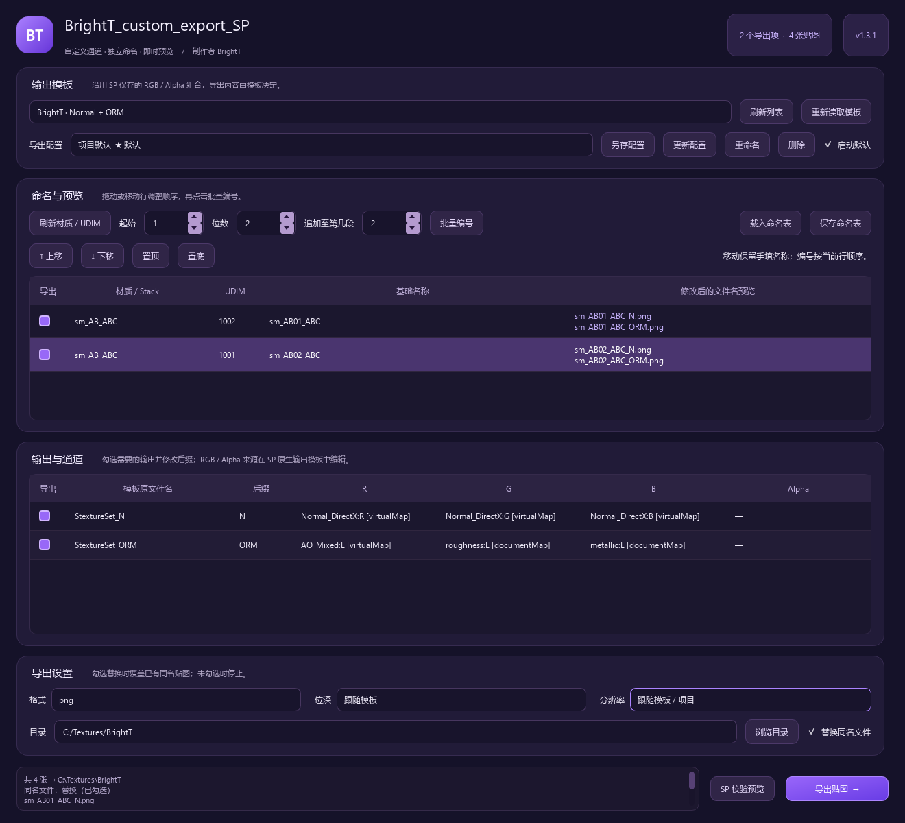

# BrightT_custom_export_SP

**制作者：BrightT · 版本：1.3.1**

Substance 3D Painter 自定义贴图命名导出插件。按材质、Stack 或 UDIM 分别指定文件名，沿用 SP 输出模板的 RGB / Alpha 通道组合，并即时预览改名结果。



图中为真实 Qt 窗口渲染，使用模拟项目数据展示；不是 SP 实机导出截图。

## 下载

[下载 v1.3.1 安装包](downloads/BrightT_custom_export_SP_v1.3.1.zip)

## 安装与升级

1. 关闭 SP，解压安装包。
2. 将 `BrightT_custom_export_SP.py` 复制到下面的目录。没有目录时手动创建。
3. 重启 SP，在 **Python** 菜单启用 `BrightT_custom_export_SP`。
4. 打开项目，从 **File（文件）→ BrightT_custom_export_SP…** 打开面板。

```text
你的“文档”\Adobe\Adobe Substance 3D Painter\python\plugins\
```

只需复制 `.py` 文件，不需要将整个文件夹复制到插件目录；无需另装 Python 或第三方库。

**从 v1.0 / v1.1 升级：** 软件文件名已改变。先保存旧插件中的命名表并关闭 SP，将旧 `sp_custom_export.py` 移出 `python/plugins` 目录，再安装新文件，避免出现两套菜单。v1.3.1 仍可读取旧版命名表 JSON。从 v1.2.0 / v1.3.0 升级时关闭 SP 后替换同名文件即可。

如系统“文档”由 OneDrive 管理，请使用实际的文档目录。

## 单页界面

深紫色背景、圆角卡片、亮紫色操作按钮；所有操作在同一页，无侧栏、多级导航或标签页。

| 区域 | 用途 |
| --- | --- |
| 输出模板 | 选择 SP 已保存模板；保存、更新、重命名或删除导出配置；指定启动默认 |
| 命名与预览 | 拖动 / 上移 / 下移 / 置顶 / 置底调整行顺序；编辑名称、按当前顺序编号和预览 |
| 输出与通道 | 勾选输出贴图、修改后缀、核对 R / G / B / Alpha 来源 |
| 导出设置 | 设置格式、位深、分辨率、保存目录和是否替换同名文件 |
| 底部操作 | 查看状态、SP 校验预览、导出贴图 |

窗口较小时可向下滚动查看设置，底部校验和导出按钮保持可用。

数值框和下拉框禁用滚轮修改，即使已获得焦点也不会因滚动误改。数值可手动输入、使用键盘方向键或点击右侧上下箭头；下拉选项需打开列表选择。格式、位深、分辨率的标签与各自下拉框紧凑排列。

## 使用流程

### 1. 在 SP 中配置贴图通道

打开 SP 原生 **Export Textures → Output Templates（输出模板）**，创建或编辑模板并保存。例如可将一张组合贴图配置为：

| 输出通道 | 来源示例 |
| --- | --- |
| R | AO_Mixed |
| G | roughness |
| B | metallic |
| Alpha | opacity（需要时添加） |

关闭原生导出窗口，再打开插件并选择这个模板。导出哪些贴图、如何组合 RGB / Alpha、使用哪种法线方向，由模板决定。

插件内显示通道来源；修改通道组合请回到 SP 原生输出模板编辑。模板未出现时点击“刷新列表”，模板修改后点击“重新读取模板”。插件是模态窗口，编辑原生模板前应保存命名表并关闭插件窗口。

### 2. 修改基础名称和后缀

在“命名与预览”表中勾选导出行，双击基础名称，例如填写 `sm_AB01_ABC`。在“输出与通道”表中勾选需要的输出，并设置后缀，例如 `N` 或 `ORM`。

```text
最终文件名 = 基础名称 + _ + 后缀 + 扩展名
sm_AB01_ABC + _ + N + .png = sm_AB01_ABC_N.png
```

基础名称不包含 `_N` 或扩展名。模板原文件名中的变量被上述命名规则取代；后缀推导只是建议，复杂模板名称请手动检查。

批量编号默认从 1 开始、2 位、追加到下划线分隔的第 2 段后。点击“批量编号”将 `sm_AB_ABC` 变为 `sm_AB01_ABC`，只处理勾选行。编号按界面从上到下的当前顺序进行。材质列或行可拖动排序，也可先选中一行，再点击上移、下移、置顶或置底。移动保留手填名称和勾选状态；排序完成后再点击“批量编号”。起始、位数、追加段位均支持右侧上下箭头微调和直接输入。反复点击会重新从原始材质名生成，不会反复追加编号。

### 3. 查看预览并导出

右侧“修改后的文件名预览”会随名称、后缀、勾选项或格式修改即时刷新，多张贴图分行显示，重复命名会提示。

选择保存目录后，点击 **SP 校验预览**，由 SP 接口核对实际待导出文件清单。确认后点击 **导出贴图 →**。实时预览是文件名预估，不是纹理图像预览；导出时也会重新校验。

### 4. 保存命名表

使用“保存命名表”保存 JSON，之后通过“载入命名表”恢复。新版命名表 JSON（v3）保存行顺序、行名称、行勾选及完整导出设置，载入时按材质 / Stack / UDIM 身份匹配；新增行追加在末尾。兼容 v1 / v2 命名表。

保存的导出设置包括 SP 模板标识、输出后缀与勾选、格式、位深、分辨率、保存目录、编号参数和替换同名文件选项；不包含 SP 模板定义本体。换电脑时先安装相同的 SP 输出模板。刷新材质表会保留已匹配行的顺序、名称和勾选；重新读取模板会重置输出项。关闭窗口前需主动保存。

## 保存导出配置与默认模板

“SP 输出模板”决定 RGB / Alpha 如何组合；新增的“导出配置”保存插件中的整套输出选项。

1. 选择 SP 输出模板，调整贴图勾选、后缀、格式、位深、分辨率、目录、编号参数和替换选项。
2. 点击“另存配置”，输入自己的名称；可保存多份配置。
3. 选择已有配置后随意调整设置，点击“更新配置”覆盖保存。也可重命名或删除。
4. 勾选“启动默认”，以后打开插件会自动加载这份已保存配置。取消勾选即可清除默认。
5. 修改默认配置后也要点击“更新配置”，未保存的界面修改不会自动写入配置。

导出配置跨项目使用，不改变项目的材质顺序和名称；项目专属顺序与名称用“保存命名表”保存。切换配置会立即载入其保存设置，包括目录和替换选项。导出配置保存在系统用户配置目录中的 `BrightT_custom_export_SP/profiles.json`。引用的 SP 模板不存在或输出列表不兼容时会报错，需先导入模板或重新选择模板后更新配置。

## 是否替换同名文件

- 初次使用默认不勾选：遇到已有同名文件停止，保留原文件。
- 勾选“替换同名文件”：允许替换本次输出清单内的同名贴图，其他文件不动。
- 替换前先完成全部贴图导出，再备份将被覆盖的文件；发布中途发生错误时尝试恢复原文件。
- 不论是否勾选，同一批次内部重名仍然报错。SP 校验预览的状态区显示本次替换策略。
- 此选项会随导出配置和 v3 命名表一起保存与恢复。

## 命名示例

将法线后缀设为 `N`，并使用 PNG：

| 场景 | 原始材质 / UDIM | 基础名称 | 最终文件名 |
| --- | --- | --- | --- |
| 单材质 | sm_AB_ABC | sm_AB01_ABC | sm_AB01_ABC_N.png |
| 双材质 1 | sm_AB_ABC | sm_AB01_ABC | sm_AB01_ABC_N.png |
| 双材质 2 | sm_AB_ABD | sm_AB02_ABD | sm_AB02_ABD_N.png |
| 同材质 UDIM 1001 | sm_AB_ABC / 1001 | sm_AB01_ABC | sm_AB01_ABC_N.png |
| 同材质 UDIM 1002 | sm_AB_ABC / 1002 | sm_AB02_ABC | sm_AB02_ABC_N.png |

同一行同时勾选 `N` 和 `ORM` 时，会输出两张贴图，例如 `sm_AB01_ABC_N.png` 和 `sm_AB01_ABC_ORM.png`。

## 导出设置与边界

- 格式、位深默认跟随各输出的模板参数；没有定义时补为 PNG / 8 位。
- 分辨率默认跟随模板；模板未指定时跟随项目。可统一覆盖为 512～8192。
- 扩边和抖动保留模板设置；缺失时使用无限扩边和关闭抖动。
- 法线方向由模板来源决定，例如 `Normal_DirectX` 或 `Normal_OpenGL`。
- TGA 请选择 8 位；其他格式与位深的有效性由 SP 校验。
- 不读取原生导出窗口当前选项或全局覆盖设置，也不执行 glTF 等动态内置导出的额外模型 / 脚本流程。
- UDIM 项目需要采用真正的 UV Tiles 工作流。输出不追加 1001 / 1002；依靠 UDIM 文件名自动识别的下游软件需要手动关联贴图。
- 不修改原材质名、Texture Set 名、UV 或图层内容。
- 拦截同批次重名；已有文件按“替换同名文件”选项处理。先写临时目录，检查成功后发布；失败时保留中间文件和可能的原文件备份，并显示路径。

## 验证状态

- 已通过 27 项独立逻辑测试：命名场景、UDIM / Stack 筛选、RGBA 保留、模板深拷贝、格式预览、配置一致性、重名检测、文件发布、替换失败回滚、行顺序恢复及配置持久化。
- 已渲染真实 Qt 界面，并使用模拟 SP 接口测试改名、后缀、拖放处理、移动行、刷新保序、默认配置重开、重命名配置、命名表顺序恢复、替换开关、数值箭头点击和 SP 预览适配。
- v1.3.1 已检查宽窗口与小窗口布局、上下箭头点击，以及全部数值框和下拉框在获得 / 未获得焦点时的双向滚轮防误改；仍需在 SP 中确认修正后的显示。
- 尚未在真实 SP 项目内验证导出图像、像素通道及版本兼容性。

运行逻辑测试（开发者用，SP 使用者无需执行）：

```sh
python -m unittest discover -s tests -v
```

需要 SP 提供 `list_resource_export_presets` / `list_output_maps` 接口。界面包含 PySide2 / PySide6 分支，但不表示所有旧版本均已实测。报错时记录 SP 完整版本、Python 控制台错误文字及是否使用 UV Tiles。

## 版本记录

- **1.3.1**：修正上下箭头错位；格式、位深、分辨率标签贴近对应下拉框；禁止数值框和下拉框通过滚轮修改。
- **1.3.0**：材质 / UDIM 自由排序、按当前顺序编号；保存导出配置与启动默认；可选同名文件替换及失败回滚；数值框上下箭头。

- **1.2.0**：品牌与作者统一为 BrightT；软件名改为 BrightT_custom_export_SP；新增深紫色单页界面和预览高亮。
- **1.1**：读取 SP 输出模板，保留 RGB / Alpha 组合，新增实时命名预览。
- **1.0**：初版材质 / UDIM 自定义命名导出。

接口依据：[Adobe 导出 API](https://experienceleague.adobe.com/en/docs/substance-3d-dev/painter-python/api/substancepainter-package/export)。
